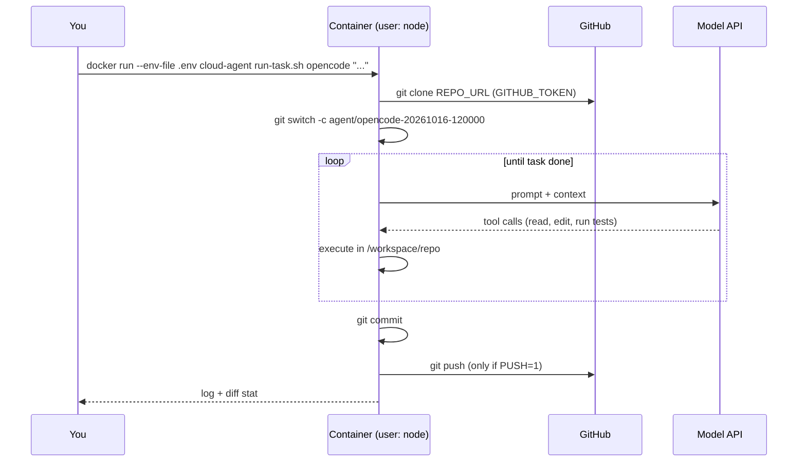

# Cloud agent runner: any coding agent, one command

A small, runnable environment for running **any of the 15 coding agents in this repo** headlessly: Claude Code, Codex, Cursor CLI, OpenCode, Pi, OMP, Devin CLI, Aider, Amp, Copilot CLI, Crush, Factory Droid, Gemini CLI, goose and Qwen Code.

- `install-agents.sh` installs the agents you choose, without root.
- `run-task.sh <agent> "<task>"` runs one task on a fresh branch with that agent's headless flags, commits the result and logs the run.
- The `Dockerfile` packages both into a non-root container. `bootstrap-vm.sh` does the same on a plain VM. On Northflank, [`launch.sh`](../northflank-parallel-harnesses/README.md) copies both scripts into each harness.

The per-agent install and run commands are generated from [`data/agents.json`](../../data/agents.json), the same data behind the [agent guides](../../agents/README.md), so the scripts and the docs always match.

```
cloud-agent-runner/
├── Dockerfile          # node:22 base, agents chosen with --build-arg AGENTS=...; runs as "node"
├── install-agents.sh   # install agents into $HOME (no root)
├── run-task.sh         # branch → run agent headless → commit → optionally push
├── entrypoint.sh       # git identity, token-based HTTPS auth, clone REPO_URL
├── bootstrap-vm.sh     # the same setup on a plain Ubuntu/Debian VM
└── .env.example        # every variable the scripts and agents read
```

## What happens when you run a task



## Run it with Docker

```bash
docker build --build-arg AGENTS="claude-code codex opencode" -t cloud-agent .
# or every agent: --build-arg AGENTS=all

cp .env.example .env
# edit .env: REPO_URL, GITHUB_TOKEN, and the credentials for your agents
```

Then run a task with any installed agent:

```bash
docker run --rm --env-file .env cloud-agent run-task.sh claude-code "Add tests for parseDate() and make them pass"
docker run --rm --env-file .env cloud-agent run-task.sh codex       "Fix the typos in README.md"
docker run --rm --env-file .env cloud-agent run-task.sh opencode    "Replace deprecated datetime.utcnow() calls"
```

Push the branch so you can open a pull request:

```bash
docker run --rm --env-file .env -e PUSH=1 cloud-agent run-task.sh opencode "..."
```

Or open a shell and use an agent interactively:

```bash
docker run --rm -it --env-file .env cloud-agent
# inside the container, in /workspace/repo:
opencode
```

## What each agent runs

`run-task.sh` uses each agent's documented non-interactive mode with prompts turned off. The container is the isolation boundary, so it doesn't hold anything except one repository and scoped credentials.

<!-- BEGIN GENERATED: cheatsheet -->
```bash
# Claude Code
claude -p "Fix the failing tests" --permission-mode acceptEdits \
  --allowedTools "Read,Edit,Write,Bash" --output-format json
# Codex CLI
codex exec --sandbox workspace-write "Fix the failing tests"
# Cursor CLI
agent -p --force --trust --output-format text "Fix the failing tests"
# OpenCode
opencode run --auto -m anthropic/claude-sonnet-5-5 "Fix the failing tests"
# Pi
pi -p --model anthropic/claude-sonnet-5-5 "Fix the failing tests"
# OMP
omp -p --yolo --model anthropic/claude-sonnet-5-5 "Fix the failing tests"
# Devin CLI
devin -p "Fix the failing tests" --permission-mode dangerous \
  --respect-workspace-trust false
# Aider
aider --message "Fix the failing tests" --yes-always --no-auto-commits
# Amp
amp -x "Fix the failing tests"
# Crush
crush run -q "Fix the failing tests"
# Factory Droid
droid exec --auto medium "Fix the failing tests"
# Gemini CLI
gemini -p "Fix the failing tests" --approval-mode=yolo
# GitHub Copilot CLI
copilot -p "Fix the failing tests" --allow-all-tools --no-ask-user
# goose
GOOSE_PROVIDER=anthropic GOOSE_MODEL=claude-sonnet-5-5 \
  goose run --no-session -t "Fix the failing tests"
# Qwen Code
qwen -p "Fix the failing tests" --approval-mode yolo
```
<!-- END GENERATED: cheatsheet -->

## Run several agents in parallel

Each `docker run` gets its own filesystem, clone and branch, so parallel tasks can't step on each other. That includes different agents on the same task:

```bash
task="Find out why tests/auth.test.ts fails intermittently and fix the cause"
for agent in claude-code codex opencode gemini-cli; do
  docker run -d --env-file .env -e PUSH=1 cloud-agent run-task.sh "$agent" "$task"
done
docker ps                    # watch them
docker logs -f <container>   # follow one
```

Branch names include the agent and a UTC timestamp to the second. Set `TASK_BRANCH` to choose the name yourself.

## Keep the workspace between runs

By default the container is ephemeral. To keep the clone and installed dependencies, mount a volume at `/workspace`; `entrypoint.sh` then fetches instead of re-cloning:

```bash
docker volume create agent-workspace
docker run --rm --env-file .env -v agent-workspace:/workspace cloud-agent run-task.sh pi "..."
```

[Persistent vs ephemeral environments](../../guides/persistent-vs-ephemeral.md) covers the trade-off.

## Without Docker: a plain VM or a Northflank empty-sandbox harness

On a fresh Ubuntu 22.04+ or Debian 12+ VM, as a normal user:

```bash
git clone https://github.com/northflank-examples/cloud-coding-agent-starter-pack.git
bash cloud-coding-agent-starter-pack/examples/cloud-agent-runner/bootstrap-vm.sh claude-code opencode goose
exec $SHELL -l
```

That installs git and tmux with apt, then the agents you list (plus a user-level Node.js 22 if an npm-based agent needs one), and puts `run-task.sh` in `~/.local/bin`. Then clone your repository and run `run-task.sh <agent> "<task>"` from inside it.

Where you can't or don't want to use apt (for example a Northflank empty-sandbox harness), `install-agents.sh <agent>...` alone is enough: it needs only `curl`, `tar` and `xz`, and installs everything, including Node.js when an agent needs it, under `$HOME`, which on Northflank is the persistent workspace.

## Configuration reference

| Variable | Read by | Purpose |
| --- | --- | --- |
| `REPO_URL` | entrypoint | HTTPS URL to clone into `/workspace/repo` |
| `REPO_BRANCH` | entrypoint | Branch to check out (default: the remote's default branch) |
| `GITHUB_TOKEN` | entrypoint, git | Used for HTTPS clone and push to github.com. Read from the environment on each git call and never written to disk |
| Agent credentials | each agent | See `.env.example` and the agent's guide |
| `TASK_BRANCH` | run-task | Branch to work on; reused if it exists |
| `PUSH` | run-task | `1` to push the branch when done |
| `LOG_DIR` | run-task | Where run logs go (default `~/agent-logs`) |
| `CLAUDE_ALLOWED_TOOLS`, `CLAUDE_MAX_BUDGET_USD` | run-task (claude-code) | Tools allowed without asking; spend cap per run |
| `CODEX_SANDBOX` | run-task (codex) | `read-only`, `workspace-write`, or `danger-full-access` (the image's default, because Codex's own sandbox often can't start inside Docker) |
| `OPENCODE_MODEL`, `PI_MODEL`, `CRUSH_MODEL` | run-task | `provider/model` for those agents |
| `DROID_AUTO` | run-task (droid) | `low`, `medium` (default) or `high` |
| `OMP_MODEL` | run-task (omp) | `provider/model` for OMP |
| `DEVIN_PERMISSION_MODE` | run-task (devin-cli) | Default `dangerous`; `accept-edits` allows file edits only |
| `GEMINI_APPROVAL_MODE`, `QWEN_APPROVAL_MODE` | run-task | Default `yolo`; `auto_edit` / `auto-edit` allows file edits only |

The image also turns off self-updating for every agent that documents a setting for it, so a run can't change version halfway through. Rebuild the image to update.

## Security notes

- **The container is the security boundary.** Every agent here runs with its permission prompts off, and several (Pi, OMP, Amp, goose, Crush in `run` mode) never ask in the first place. That's acceptable only because the container holds nothing but one repo and scoped tokens. Don't run `run-task.sh` on your laptop outside a container or VM.
- **Non-root.** The image runs as `node`. Claude Code refuses `--dangerously-skip-permissions` as root, and nothing here needs root.
- **Restrict network egress** at the platform level if you can: allow your git host, the model API, and package registries.
- **Branch protection.** Protect `main` so agent tokens can only push to `agent/*` branches, and merge through pull requests.

More in [Security and secrets](../../guides/security-and-secrets.md).

## What hasn't been tested

The scripts pass `bash -n` and `run-task.sh`'s per-agent commands are taken from each vendor's docs, but the image hasn't been built and run against every agent. Agent CLIs change often: if a flag stops working, check that agent's guide and open an issue.
