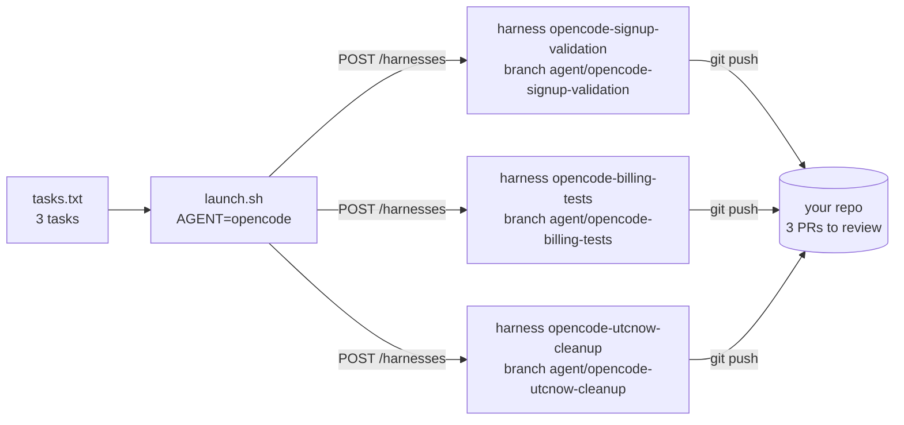

# Run many coding agents in parallel on Northflank

Turn a list of tasks into parallel coding agents: Claude Code, Codex, Cursor, OpenCode, Pi, Devin CLI, OMP, or any of the other agents in this repo. Each task gets:

- its own **Northflank Cloud Harness**: an isolated microVM with a persistent workspace;
- its own **branch**, created from your base branch (`agent/<agent>-<task-name>`);
- the task prompt in `~/TASK.md` and `$TASK`, and this repo's [`run-task.sh`](../cloud-agent-runner/run-task.sh) to run it headlessly.

Two scripts, using the [Northflank REST API](https://northflank.com/docs/v1/api/project/harnesses/create-harness) with `curl` and `jq`:

```
northflank-parallel-harnesses/
├── launch.sh            # tasks file → one harness + branch per task
├── manage.sh            # list / pause / resume / delete them
└── tasks.example.txt    # task file format
```



## How each agent is set up

Cloud Harness has a built-in type for seven agents. Everything else runs in an **Empty sandbox** harness (`type: none`): the same microVM and persistent workspace with no agent preinstalled, plus `install-agents.sh` so you can install it with one command.

| `AGENT=` | Harness type | Authentication |
| --- | --- | --- |
| `claude-code` | `claude` (agent preinstalled) | `AGENT_API_KEY` = Anthropic API key, or leave unset and sign in inside the harness |
| `codex` | `codex` (agent preinstalled) | `AGENT_API_KEY` = OpenAI API key, or sign in with ChatGPT inside the harness |
| `cursor-cli` | `cursor` (agent preinstalled) | `AGENT_API_KEY` = Cursor API key, or sign in inside the harness |
| `opencode` | `opencode` (agent preinstalled) | Account mode (the API requires it). Pass a provider key with `AGENT_ENV`, e.g. `ANTHROPIC_API_KEY` |
| `pi` | `pi` (agent preinstalled) | Account mode (the API requires it). Pass a provider key with `AGENT_ENV`, or `/login` inside Pi |
| `omp` | `omp` (agent preinstalled) | Account mode (the API requires it). Pass a provider key with `AGENT_ENV`, or `omp login <provider>` inside the harness |
| `devin-cli` | `devin` (agent preinstalled) | Account mode (the API requires it). Sign in with `devin auth login --force-manual-token-flow` inside the harness |
| `aider`, `amp`, `copilot-cli`, `crush`, `droid`, `gemini-cli`, `goose`, `qwen-code` | `none` (Empty sandbox) | Pass the agent's key with `AGENT_ENV`; see each [agent guide](../../agents/README.md) for the variable names |

The harness types and auth modes come from the [create-harness API reference](https://northflank.com/docs/v1/api/project/harnesses/create-harness): *"How Codex, Claude and Cursor authenticate. Pi, OMP, Devin CLI and OpenCode require `account`; agentless harnesses omit this field."*

## Prerequisites

- A Northflank project, with your Git provider [linked](https://northflank.com/docs/v1/application/getting-started/link-your-git-account) and able to access the repository
- A Northflank API token (**API tokens** in your team or organization settings, [docs](https://northflank.com/docs/v1/application/secure/grant-api-access)) whose role includes **Project → Harnesses** permissions
- A credential for your agent (see the table above)
- `bash`, `curl` and `jq`

## Launch

```bash
export NF_API_TOKEN=...            # Northflank API token
export NF_PROJECT=my-project       # project ID
export REPO_URL=https://github.com/your-org/your-repo

cp tasks.example.txt tasks.txt     # edit: one "name: prompt" per line
```

Claude Code, Codex or Cursor with an API key:

```bash
AGENT=claude-code AGENT_API_KEY=sk-ant-... DRY_RUN=1 ./launch.sh tasks.txt   # check the requests (secrets masked)
AGENT=claude-code AGENT_API_KEY=sk-ant-... ./launch.sh tasks.txt
```

OpenCode, Pi or OMP, with a provider key passed into each harness:

```bash
export ANTHROPIC_API_KEY=sk-ant-...
AGENT=opencode AGENT_ENV="ANTHROPIC_API_KEY" ./launch.sh tasks.txt
```

Any other agent, for example Gemini CLI or goose:

```bash
export GEMINI_API_KEY=...
AGENT=gemini-cli AGENT_ENV="GEMINI_API_KEY" ./launch.sh tasks.txt

export ANTHROPIC_API_KEY=sk-ant-... GOOSE_PROVIDER=anthropic GOOSE_MODEL=claude-sonnet-5-5
AGENT=goose AGENT_ENV="ANTHROPIC_API_KEY GOOSE_PROVIDER GOOSE_MODEL" ./launch.sh tasks.txt
```

```
created opencode-signup-validation  branch agent/opencode-signup-validation
created opencode-billing-tests  branch agent/opencode-billing-tests
created opencode-utcnow-cleanup  branch agent/opencode-utcnow-cleanup
```

Other options: `BASE_BRANCH=develop`, `REPO_TYPE=gitlab`, `PLAN=nf-compute-400-16` (4 vCPU / 16 GB for heavy test suites).

`AGENT_ENV` values are set as runtime variables on each harness, readable by anyone who can open it. In shared projects, use per-harness keys you can revoke, and make harnesses private if your team allows it (private harnesses are reachable only through the in-app terminal).

## Run the tasks

Open a harness's terminal in Northflank (or SSH in with `northflank dev ssh`). The repo is cloned in `/home/harness/repo` and the prompt is in `TASK.md`:

```bash
cd /home/harness/repo
bash ~/install-agents.sh "$AGENT"        # empty-sandbox harnesses only; installs into /home/harness
source ~/.bashrc
bash ~/run-task.sh "$AGENT" "$(cat ~/TASK.md)"
git push -u origin HEAD
```

`run-task.sh` works on `$TASK_BRANCH`, runs the agent with the headless flags for that agent, commits the result and writes a log to `~/agent-logs/`. Set `PUSH=1` to push automatically. Every agent works in its own microVM on its own branch, so they can't conflict.

## Same task, different agents

Run the same task file once per agent to compare them. Harness and branch names include the agent, so nothing collides:

```bash
AGENT=claude-code AGENT_API_KEY=$ANTHROPIC_API_KEY ./launch.sh tasks.txt
AGENT=codex       AGENT_API_KEY=$OPENAI_API_KEY    ./launch.sh tasks.txt
AGENT=opencode    AGENT_ENV="ANTHROPIC_API_KEY"   ./launch.sh tasks.txt
```

Free Northflank projects support one harness, so running several in parallel needs a paid project.

## Pause, resume, clean up

```bash
./manage.sh list                 # id and status of every harness in the project
./manage.sh pause --all          # stop compute billing for all task harnesses; workspaces kept
./manage.sh resume opencode-billing-tests
./manage.sh delete --all         # asks you to type 'delete' first; push branches before this
```

`--all` matches harnesses whose names start with an agent id, which is how `launch.sh` names them. The same operations are available in the CLI: `northflank pause harness`, `northflank resume harness`, `northflank delete harness`.

## What this hasn't been tested against

The request bodies follow the API reference and pass `DRY_RUN`, but check one harness end to end before launching many:

- whether the harness checks out the new `branchData` branch itself (the run step switches to `$TASK_BRANCH` either way);
- that an empty-sandbox harness's base image has `curl`, `tar` and `xz`, which `install-agents.sh` needs (it downloads Node.js 22 into `~/.local/node` for npm-based agents when `node` is missing).
