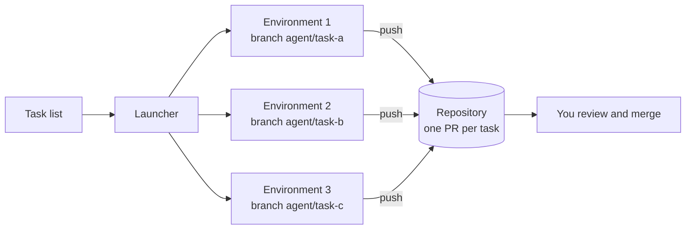

# Running many coding agents in parallel

**Short answer:** give every task its own environment and its own branch, start them all at once, and review each result as a pull request. Agents in separate environments can't overwrite each other's files, and branches keep their changes apart until you merge. The same pattern works for any agent, and for different agents on the same task.

## The pattern



1. **One environment per task.** A separate VM, container or harness each. Agents run tests, install packages and leave build artefacts; sharing a working tree means one agent's `npm install` or half-written file breaks another's test run.
2. **One branch per task**, named after the task (`agent/signup-validation`), created from the same base commit.
3. **Headless runs.** Each agent runs to completion with no permission prompts, inside an environment that holds only what it needs. See [Running agents headlessly](running-agents-headless.md).
4. **Pull requests as the merge point.** CI runs on every branch, and you review each change on its own.
5. **Clean up.** Pause or delete each environment once its branch is pushed.

## Three ways to launch them

| | How | Good for |
| --- | --- | --- |
| **Northflank Cloud Harness** | [`launch.sh`](../examples/northflank-parallel-harnesses/README.md) makes one API call per task. Each harness is a microVM with the agent installed, the repo cloned on its own branch and the prompt in `TASK.md` | Any number of tasks, with persistent workspaces you can open later to inspect or continue |
| **Containers** | One `docker run ... run-task.sh <agent> "<task>"` per task using [the example image](../examples/cloud-agent-runner/README.md), on any Docker host or Kubernetes | Short, fully automated tasks where the environment is thrown away |
| **CI jobs** | A matrix job in GitHub Actions or another CI system, one job per task | Teams that already run everything through CI |

## Same task, different agents

Agents differ on any given task. A cheap way to find out which one suits your codebase is to give the same task to several of them and compare the pull requests:

```text
# tasks.txt for launch.sh, with AGENT set per run
fix-flaky-auth-test: Find out why tests/auth.test.ts fails intermittently, fix the cause, and run it 20 times to confirm
```

```bash
for agent in claude codex opencode; do
  AGENT=$agent ./launch.sh tasks.txt   # harness names are prefixed with the agent
done
```

Or with containers:

```bash
task="Find out why tests/auth.test.ts fails intermittently and fix the cause"
for agent in claude-code codex opencode gemini-cli; do
  docker run -d --env-file .env -e PUSH=1 cloud-agent run-task.sh "$agent" "$task"
done
```

Each run pushes its own `agent/<agent>-<timestamp>` branch. Compare them on the things you care about: did the tests pass, how big is the diff, how much did it cost, how long did it take. Repeat on a handful of real tasks before drawing conclusions; one task says little.

## Sizing the batch

- **Rate limits are usually the first limit, not compute.** Ten agents on one API key share that key's requests-per-minute and tokens-per-minute limits. Check your provider's limits before launching dozens, and use separate keys per team or workload if you need separate limits.
- **Subscription plans have usage caps.** Running many agents on one personal subscription uses up its allowance quickly, and some plans' terms limit automated use. API keys are the usual choice for parallel automated work.
- **Compute is cheap per task.** On Northflank, ten 2 vCPU / 4 GB environments for an hour cost about $0.67 in total (see the [parallel-agents scenario](../scenarios/parallel-agents.md)). Model usage normally costs far more.
- **Review is the real bottleneck.** Ten agents produce ten pull requests. Start with fewer, well-scoped tasks than you think you can handle.

## Writing tasks that parallelise well

- **Independent.** Two tasks that both edit `src/billing/` will conflict at merge time even though the agents never saw each other.
- **Verifiable.** "Add tests for `parseDate` and make them pass" has an end state the agent can check. "Improve the code" doesn't.
- **Scoped.** Name the files or module. Smaller context means faster, cheaper and more reliable runs.
- **Self-contained.** The agent can't ask you questions mid-run. Put the acceptance criteria in the prompt.

## Related

- [Running agents headlessly](running-agents-headless.md): the one-line command for each agent
- [Managing agents in the cloud](managing-agents.md): lifecycle, logs, updates and cost tracking
- [Persistent vs ephemeral environments](persistent-vs-ephemeral.md)
- [Security and secrets](security-and-secrets.md)
